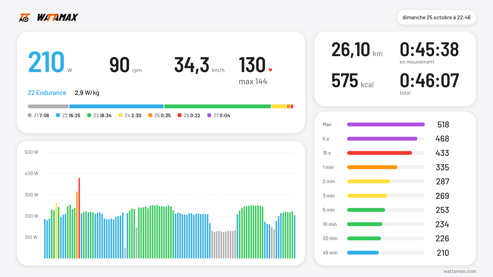

<h1 align="center">
  
  <picture>
    <source media="(prefers-color-scheme: dark)" srcset="assets/wattamax-wordmark-white.svg">
    
  </picture>
</h1>

<p align="center">
  Your watts on a big screen, straight from your smart trainer.<br>
  Free, in the browser, with nothing to install and no account.
</p>

<p align="center"><b><a href="https://wattamax.com">wattamax.com</a></b></p>

<p align="center">
  
</p>

I only wanted to see my watts on my Elite Suito, and paying for Zwift or Rouvy just for that felt silly. So I wrote a web page that connects to the trainer over Bluetooth and shows what matters while you ride. At the end you get the summary above as an image, plus a file for Strava.

## What it does

- Shows your power (averaged over 3 seconds so you can read it), cadence and speed, each with its ride average. Wear a Bluetooth heart rate strap and your heart rate joins them.
- Colours every figure and bar with your power zone once you enter your FTP, and adds up the time you spend in each zone.
- Tracks your rolling average and your best effort over 5 s, 15 s, 1, 2, 3, 5, 10, 20 and 45 minutes.
- Pauses by itself when you stop pedalling and starts again when you pedal.
- Lets you rearrange the screen on a computer: resize the cards, drag them around, and the numbers grow to fill the space.
- Gives a realistic speed. Trainers report how fast their flywheel spins, which says little about your power, so the page simulates the speed you'd ride at on a flat road.
- Exports the ride as a recap image and a FIT file that Strava files as a Virtual Ride. On the Strava map the ride traces a drawing of your choice across the Salar de Uyuni.
- Keeps your data in your browser. There are no cookies and no third-party requests; the host only counts visits, anonymously.

It has only been tested with a Suito, but it should work with any trainer that supports Bluetooth FTMS, which covers most smart trainers sold in the last few years (Wahoo Kickr, Tacx Neo and Flux, Elite Direto and Justo, Saris H3...). The page is in English, French, German, Italian or Spanish. It picks your browser's language, and the flag at the top right switches to the next one on each click. Each language also has its own address, like [wattamax.com/de](https://wattamax.com/de).

## Which browser?

The page relies on Web Bluetooth, and only Chromium-based browsers implement it.

| Browser | Works? |
| --- | --- |
| Chrome, Edge or Opera on Windows, macOS, ChromeOS | Yes |
| Chrome on Linux | Yes, after enabling `chrome://flags/#enable-experimental-web-platform-features` |
| Chrome on Android | Should work, not tested yet |
| Firefox, Safari | No |
| iPhone or iPad | Only in the Bluefy browser app from the App Store |

## Riding

1. Close Zwift, the Elite app or anything else connected to the trainer. It only accepts one Bluetooth connection at a time.
2. Pedal for a few seconds to wake the trainer up.
3. Open [wattamax.com](https://wattamax.com), click **Connect your trainer** and pick your trainer in the list.
4. Start pedalling. The clock starts with your first pedal stroke.
5. Hold **Hold to finish** for 2 seconds when you're done. Holding the button replaces a confirmation dialog, so a stray click can't end your ride.

The two fields at the top hold your weight and FTP (the power you can hold for about an hour), set to 75 kg and 200 W until you enter your own. Your weight gives watts per kilo and feeds the speed simulation. Your FTP sets the zones, from Z1 (recovery) to Z7 (sprint). Both fields pulse red until you fill them, and if you empty one, whatever depends on it disappears. Your browser remembers both, along with the two switches.

The ride pauses once the trainer has reported a cadence of 0 for a second. Some trainers take a while to notice you've stopped: the Suito keeps showing your last cadence for about 5 seconds, so its rides pause about 6 seconds after you stop. Turn **Auto-pause** off at the top if you'd rather keep the clock running.

On the right of the ride screen are the distance, the moving time, and one row per duration with your rolling average power and, in a paler bar behind it, your best so far. There's no 1 s row while riding because it flickered too much; your max power shows under the power figure instead, next to the zone and W/kg. The chart shows the last 10 minutes in 5-second bars, or the whole ride if you pick **Total** in its corner.

To add your heart rate, click the heart at the top and pick your strap in the list, before or during the ride. A strap only shows up while you wear it, and wetting its electrodes helps it pick up your beats.

To rearrange the screen, drag the edge or corner between two cards to resize them. The numbers stack on top of each other once a card is tall enough for that to make them bigger. Press a card and drag it over another one to swap them. Reloading the page brings the default layout back. Messages like "Pédale pour démarrer" float in the middle of the screen, and the small button in their corner tucks them into the top bar.

If the Bluetooth connection drops, the ride pauses and the page keeps trying to reconnect. The screen stays awake for the whole ride, and the page asks before letting you close the tab on a ride you haven't downloaded.

## After the ride

The summary is the ride screen without the live values: average power, cadence and speed (plus average and max heart rate with a strap), zone, W/kg and time in each zone, a chart of the whole ride, distance, moving time, total time and calories, and your max power and best effort over each duration. Holding **Hold to start over** starts a new ride.

**Export** opens a small window that walks you through getting the ride onto Strava:

1. Click a drawing, and a `.fit` file with power, cadence, speed and heart rate downloads. The ride will trace that drawing on the Strava map. The Wattamax wordmark comes first: picking it shows the app to everyone who sees your ride.
2. **Open Strava** opens its upload page in a new tab, where you pick the file. If Strava asks you to log in first, it lands you on your dashboard instead: the **+** at the top right gets you to the upload. Strava files the ride as a Virtual Ride, which counts in your profile totals (pick "all rides" on the weekly widget to see it there).
3. If you like, download the summary as a 1920×1080 PNG, like the one at the top of this page, and add it to the activity.

Power and cadence come straight from the trainer, speed is simulated from power, and distance comes from that speed, so it starts at zero for each ride. The trainer's own odometer doesn't reset between rides, which is why the page doesn't use it.

<details>
<summary>Why does the ride show up in Bolivia on Strava?</summary>

Getting the ride right on Strava took a few tries, because Strava fills in what an indoor file lacks on its own terms.

It only works out moving time from GPS data. Without a route, every pause counts as riding time, even with the pauses written in the file. So, like Zwift with its virtual worlds, the file gives the ride a made-up route on the Salar de Uyuni, on the open salt east of Isla Incahuasi. The route is a drawing scaled to the ride's length, so every ride draws it once from start to finish. You pick the drawing when you export: the Wattamax wordmark, WATTAMAX.COM, an organic loop, the TT, the full icon, a bike or a heart. They all live in `js/route.js`. The export window always offers the wordmark, plus eight of the others picked at random for each ride, so the choice stays short as drawings get added. The position stands still during pauses, which Strava counts as stopped.

For a regular ride, Strava takes the time zone and the elevation from the place on the map, so a ride in Bolivia would show up 6 hours early with made-up climbing. A virtual ride keeps the computer's local time and the flat elevation written in the file, and is never matched against real segments. The Salar is also the flattest place on Earth, which helps if a very long ride spills past the edge of the salt on the map.

Strava uses the distance from the file, not the length of the route, so the drawing never changes your kilometres. Power, cadence and speed stay as recorded.

</details>

## Running it yourself

It's plain HTML, CSS and JavaScript modules, with no build step and no dependencies to install. Because of the modules, opening `index.html` straight from the file system doesn't work. Clone the repo and serve the folder instead:

```
git clone https://github.com/MaxHenrotin/wattamax.git
cd wattamax
python3 -m http.server
```

Then open http://localhost:8000 in Chrome. Web Bluetooth only works on HTTPS pages and on localhost.

## How it works

Smart trainers expose the Bluetooth Fitness Machine Service (FTMS, UUID `0x1826`). The page subscribes to its Indoor Bike Data characteristic (`0x2AD2`). The trainer sends a small packet about once a second, with a flags field saying which values the packet contains. The page reads cadence and power, and skips the rest. Heart rate straps all use the standard Heart Rate Service (`0x180D`), whose Heart Rate Measurement characteristic (`0x2A37`) sends the beats per minute in one or two bytes, depending on a flag.

The trainer's speed is skipped too. Without an app setting its resistance, the trainer only reports how fast its flywheel spins, which depends on your gear and cadence rather than your power: on one test ride, 161 W averaged 22.9 km/h, where a flat road gives about 30. Like Zwift, the page works out the speed from your power instead, using the model of Martin et al. (1998). On every packet, the power that reaches the wheel, minus rolling resistance and air drag, goes into kinetic energy, so the speed builds up and dies down over a few seconds, as on a real bike. The model assumes no wind and no slope, an 8 kg bike, a drag area of 0.35 m² (sitting upright, as most people do on a home trainer), a rolling resistance of 0.004 and a drivetrain efficiency of 97.6 %. After a pause you set off again from standstill.

The code is split by job:

- `js/sensors.js` handles the Bluetooth connections to the trainer and the heart rate strap, decodes their packets and reconnects after a drop
- `js/ride.js` holds the ride logic: auto-pause, simulated speed, totals, 3-second power, rolling averages, best efforts
- `js/zones.js` defines the seven power zones and adds up the time spent in each
- `js/charts.js` draws the bar charts on a canvas
- `js/route.js` holds the drawings the virtual route follows on the Salar de Uyuni (`js/outlines.js`, generated with the logos, holds the outlines of the TT and the wordmark)
- `js/exports.js` builds the FIT file (with Garmin's FIT SDK, a copy of which sits in `js/vendor/` and only loads when you export) and the recap image
- `js/app.js` wires all of it to the page
- `fonts/` holds the Barlow files the page uses, so it never asks Google Fonts for them
